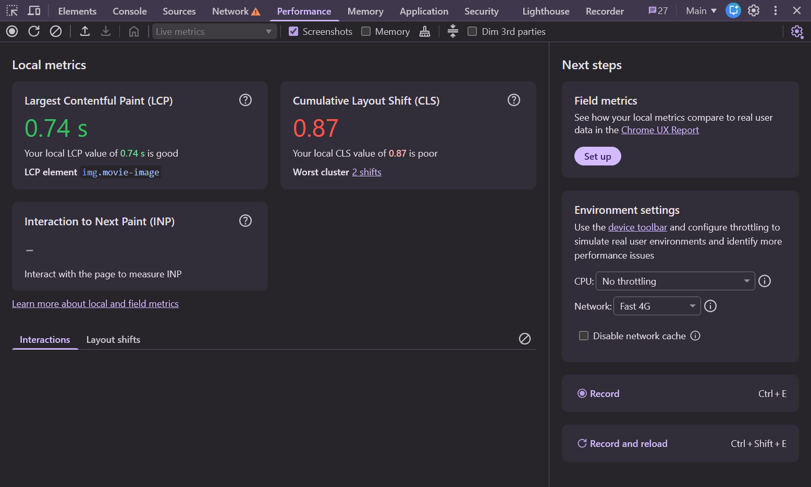
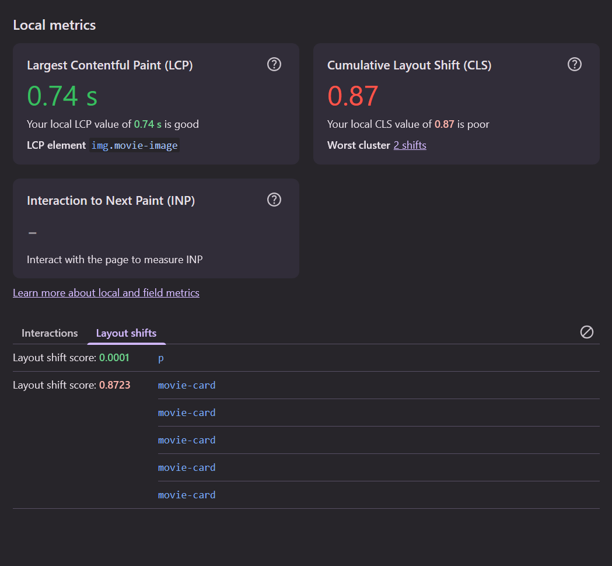
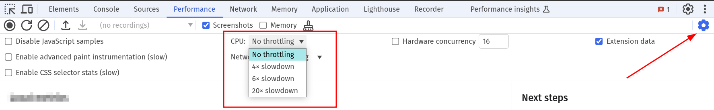
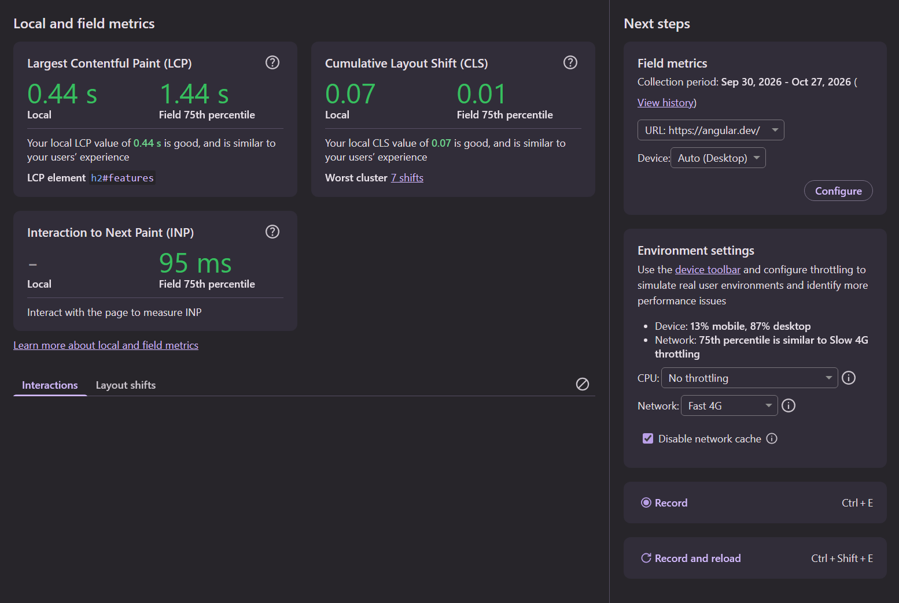

# 01. Measure Core Web Vitals

Before fixing anything, we need numbers. In this exercise you will get to know the three places
Core Web Vitals show up in Chrome - and learn why the numbers never quite match.

| Metric  | Good      | Needs improvement | Poor      |
|---------|-----------|-------------------|-----------|
| **LCP** | ≤ 2.5 s   | ≤ 4 s             | > 4 s     |
| **INP** | ≤ 200 ms  | ≤ 500 ms          | > 500 ms  |
| **CLS** | ≤ 0.1     | ≤ 0.25            | > 0.25    |

Serve the production build for this exercise:

```bash
npm run start:prod
```

## 1. Live metrics in the Performance panel

Open DevTools and go to the **Performance** panel. Without recording anything, you see the
**Local metrics** for the current page: LCP, CLS and INP.



1. Reload [http://localhost:4200/list/popular](http://localhost:4200/list/popular) and watch LCP and CLS fill in.
2. Hover the LCP value. Which element is it? Click it to jump to the element in the **Elements** panel.
3. Note down your LCP and CLS. What rating do they get?

> [!NOTE]
> INP stays empty until you interact with the page. Click a few movies, the sidebar links, the
> "Please like me" buttons. Watch the **Interactions** log below the metrics fill up.

<details>
  <summary>What you should see</summary>

On a fast machine without throttling LCP is probably "good". **CLS is not**: we measured
**0.28 - 0.87**, clearly "poor". Open the **Layout shifts** log to see which elements moved: one
big cluster made of `movie-card`s.



</details>

## 2. Your users don't have your laptop

Your development machine is much faster than the average phone, and `localhost` has no network latency.
Open the **Environment settings** next to the local metrics (or the gear icon in the Performance panel)
and set:

* **CPU throttling**: `4x slowdown` (a mid-range phone)
* **Network**: `Fast 4G`



Reload the page again and compare LCP to step 1.

<details>
  <summary>What we measured</summary>

| Setting                                        | LCP          |
|------------------------------------------------|--------------|
| no throttling                                  | ~0.6 s       |
| Fast 4G, 1280×800 window                       | **~4.3 s**   |

The same page goes from "good" to "poor".

</details>

> [!WARNING]
> Throttling stays active as long as DevTools is open on that tab. Remember to turn it off when you
> are done - and remember to turn it **on** again before every measurement in the following exercises.

## 3. Lab vs. field data

Everything you measured so far is **lab data**: one load, on your machine, with your settings.
What Google uses for ranking - and what your users actually experience - is **field data**, collected
from real Chrome users in the [Chrome UX Report (CrUX)](https://developer.chrome.com/docs/crux).

The Performance panel can show both side by side:

1. In the **Field data** section next to the local metrics, click **Set up** and enable it.
2. `localhost` has no field data, of course. Open a public site you know (your company's, a news site, …)
   in the same tab and look at the panel again.
3. Compare **local** vs. **field** values. Use the environment settings to make your local
   numbers resemble the field numbers - that's how you find a realistic throttling setup for your site.
   DevTools even suggests one: under **Environment settings** it tells you which network throttling
   matches the 75th percentile of your real users.



<details>
  <summary>Things to know about field data</summary>

* CrUX reports the **75th percentile** over the last **28 days**, split by phone and desktop.
* Only pages with enough traffic from **publicly indexable** pages are included - a logged-in SaaS app
  often has no field data at all. That's when you need your own real user monitoring (RUM).
* To see trends over time, use [CrUX Vis](https://cruxvis.withgoogle.com).

</details>

## 4. One more opinion: Lighthouse

Open the **Lighthouse** panel, choose **Mobile** and **Performance** only, and run a report for
`/list/popular`.

Lighthouse simulates a slow phone on Slow 4G. Note LCP and CLS and look at the
**Diagnostics** - you'll meet several of them again in the next exercises.

<details>
  <summary>What we measured</summary>

Performance score **0.45 - 0.55**, LCP **5.7 - 8.0 s**, CLS **0.37 - 0.81**.

Run it three times. The numbers change between runs - this is normal. Always compare the
**median of several runs**, never a single run.

</details>

## Takeaways

* **Local metrics** in the Performance panel are the fastest way to check a page.
* Measure with **throttling**, on a **production build**.
* **Lab data** helps you debug, **field data** tells you whether it matters.
* Measurements are noisy: repeat them.

Next: [02. Find and fix layout shifts](./02-cls-find-and-fix-layout-shifts.md)
