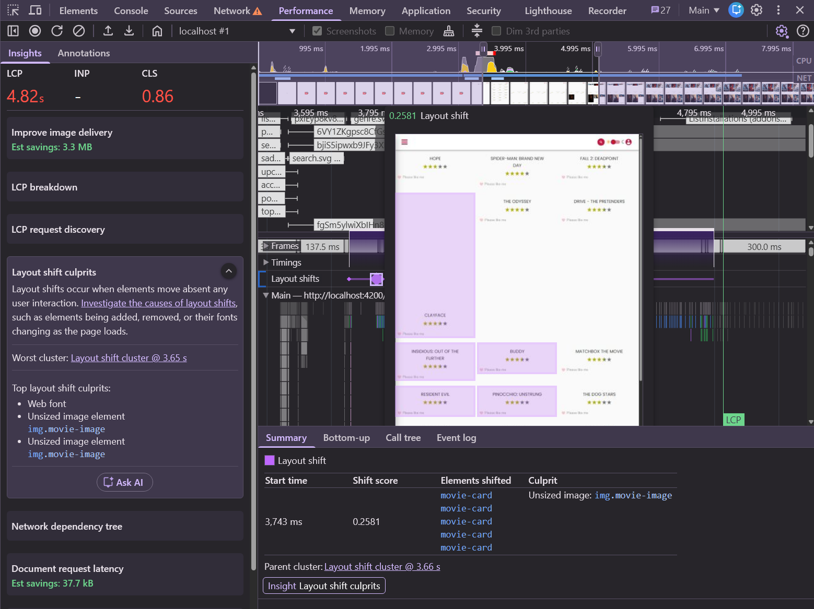
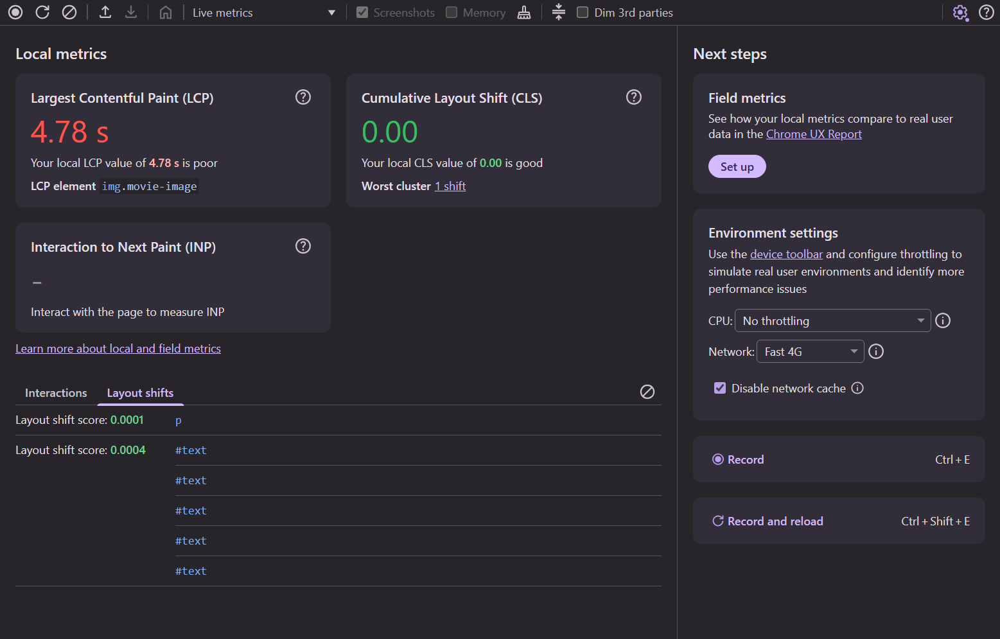

# 02. CLS: Find and Fix Layout Shifts

CLS adds up how much visible content moves around unexpectedly while the page is in use.
Each shift is scored as `impact fraction × distance fraction`: how much of the viewport moved, times
how far it moved.

In [01](./01-measure-core-web-vitals.md) you saw that our list page scores somewhere between **0.28 and 0.81** —
well beyond "poor" (> 0.25). Let's find out why.

```bash
npm run start:prod
```

## 1. See the shifts

Open [http://localhost:4200/list/popular](http://localhost:4200/list/popular) and the **Performance** panel.

Reload the page and open the **Layout shifts** log below the local metrics. Every entry lists the
elements that moved and its score. Hover an entry to highlight the elements on the page.

<details>
  <summary>Hint: what moves?</summary>

Almost every entry contains `movie-card` or `div.movie-card-content` elements. Some of them jump more than **500px**.

</details>

## 2. Find the culprit in a recording

The log tells you *what* moved. A recording tells you *why*.

1. Enable **Screenshots** in the Performance panel toolbar.
2. Hit **Record and reload** (`Ctrl + Shift + E`, Mac: `⌘ + Shift + E`).
3. Find the **Layout shifts** track. Each purple diamond is one shift, grouped into clusters.
4. Click the biggest cluster. In the **Summary** you see the moved nodes and **potential root causes**.
5. Open the **Insights** sidebar and expand **Layout shift culprits**.



Use the screenshot track to look at the page right before and after a cluster.
Which resource arrives at exactly that moment?

<details>
  <summary>Solution: the root cause</summary>

The insight reports **unsized image elements**: the movie posters.

```html
<!-- movie-card.component.ts -->

```

```css
.movie-image {
  width: 100%;
  height: auto;
}
```

The browser knows the poster's width (100% of the card), but not its height until the image has
downloaded. So every card is laid out with a **0px high image**, and each poster that arrives pushes
everything below it down by ~500px.

</details>

## 3. Reserve the space

If an `` has `width` and `height` attributes, the browser derives the aspect ratio from them
**before the image loads** and reserves the right amount of space. The CSS `width: 100%; height: auto`
still decides the final size.

Our posters are 2:3. Add `width` and `height` to the `img` in `movie-card.component.ts`.

<details>
  <summary>Solution</summary>

```html
<!-- src/app/movie/movie-card/movie-card.component.ts -->


```

Branch: `solution/02-cls-reserve-space`

</details>

Measure again, with the same settings as before. Check the local metric and the
**Layout shifts** track.

<details>
  <summary>What we measured</summary>

| Run                  | CLS on `/list/popular` |
|----------------------|------------------------|
| before (Lighthouse)  | 0.37 – 0.81            |
| after (Lighthouse)   | **0.001**              |



The only shifts left are tiny `#text` entries: the web font swap from step 4.

The movie detail page (e.g. [/movie/533535](http://localhost:4200/movie/533535)) gets better too:
its "recommendations" list below the fold uses the same `movie-card`. We measured **0.12 → 0.00**.

</details>

## 4. Web fonts

The second classic CLS source is web fonts. The app loads **Poppins** from Google Fonts with
`display=swap`, so the browser first renders text in a fallback font and swaps it once Poppins has
arrived — if the two fonts have different metrics, the text reflows.

1. In a recording of a **cold** load, find the `woff2` request in the **Network** track.
2. Do you see a layout shift right after it finished? Which elements moved?

<details>
  <summary>What we measured</summary>

In this app the font swap causes only a tiny shift (**~0.0005**) on movie titles: Poppins and the
fallback are similar enough, and most text is rendered after the font is already there.
On many real sites it's much bigger.

Options when it matters:

* **`font-display: optional`** (`&display=optional` in the Google Fonts URL): the web font is only
  used if it is available almost immediately, so it never swaps — at the price of sometimes showing the fallback.
* **Matching fallback metrics** with `size-adjust`, `ascent-override` & co. on a `@font-face` for the
  local fallback font, so the swap doesn't move anything.
  [Font style matcher](https://meowni.ca/font-style-matcher/) helps you find the values.
* **Preloading** the font file. Careful with Google Fonts: the `woff2` URLs are versioned and change
  (in this app they moved from `poppins/v23` to `poppins/v24`) — a hardcoded preload breaks silently.
  Self-host the font if you want to preload it.

</details>

## Takeaways

* The **Layout shifts** log and track tell you *what* moved, **Layout shift culprits** tells you *why*.
* Give every image (and video, ad slot, embed) **dimensions** so the browser can reserve the space.
* Use the screenshots track to see the shift with your own eyes.

Next: [03. Identify the LCP element and break it down](./03-lcp-identify-and-break-down.md)
