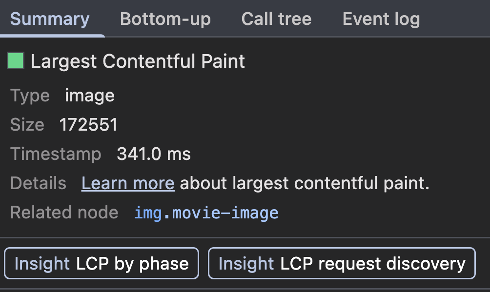
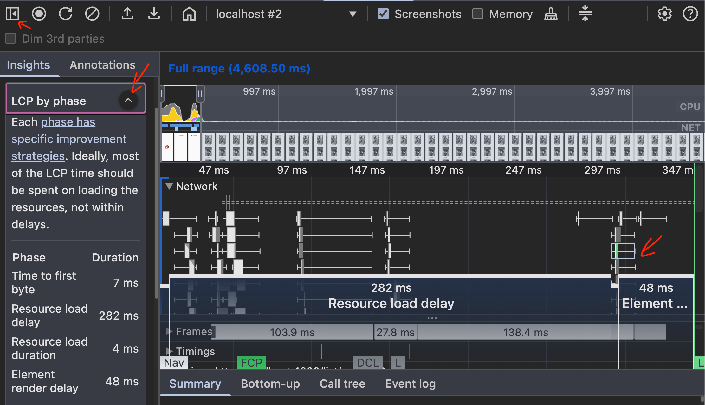
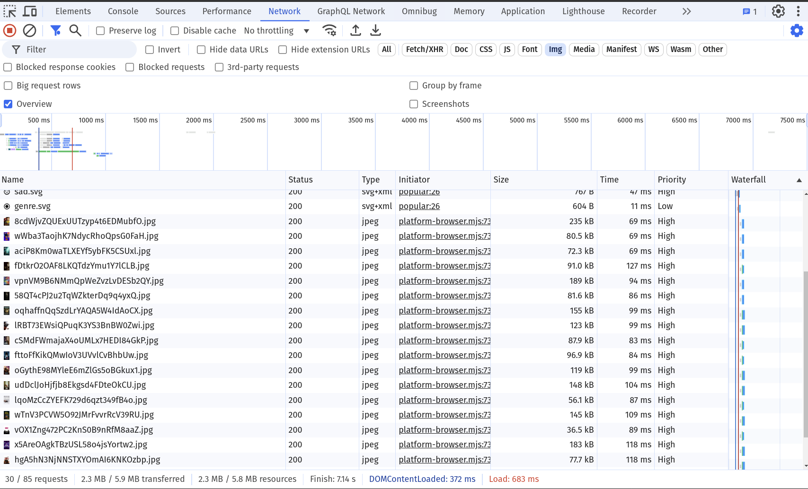
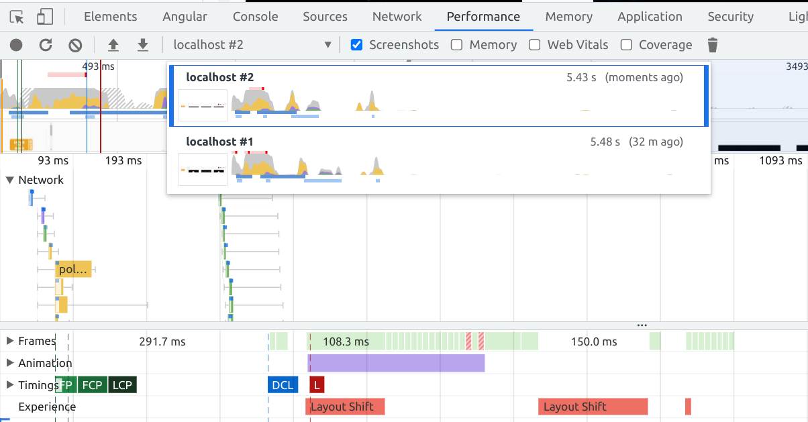

# 03. LCP: Identify the LCP Element and Break It Down

LCP marks the moment the largest image or text block in the viewport is rendered. Before you can
improve it, you need to answer two questions:

1. **Which** element is the LCP element?
2. **Where** does the time go?

For the second question, every LCP is split into four sub-parts:

| #  | Sub-part                    | From → to                                                     |
|----|-----------------------------|---------------------------------------------------------------|
| 1  | **Time to first byte**      | navigation start → first byte of the HTML                     |
| 2  | **Resource load delay**     | first byte → the browser *starts* loading the LCP resource    |
| 3  | **Resource load duration**  | start → end of the LCP resource download                      |
| 4  | **Element render delay**    | LCP resource loaded → LCP element painted                     |

For a text LCP there is no resource, so only #1 and #4 exist.

> [!TIP]
> As a rule of thumb, most of the LCP time should be spent in **#3, loading the resource**.
> Large #2 or #4 values mean the browser was waiting for something.

```bash
npm run start:prod
```

## 1. Record a page load

1. Open [http://localhost:4200/list/popular](http://localhost:4200/list/popular) and the **Performance** panel.
2. Set **Network** to `Fast 4G` (keep the cache disabled).
3. Enable **Screenshots**.
4. Click **Record and reload** (`Ctrl + Shift + E`, Mac: `⌘ + Shift + E`).


Find the **LCP** marker in the **Timings** track and click it. The **Summary** shows the LCP element
and its timing.



<details>
  <summary>Solution: the LCP element</summary>

One of the movie posters, an `img.movie-image` from `image.tmdb.org/t/p/w780/...`.

Which poster it is can change between runs! In a grid all posters in the first row have the same size,
so the one that finishes painting first becomes the LCP element. Keep this in mind when you try to
"prioritize the LCP image" in the next exercise.

</details>

## 2. Break it down

Open the **Insights** sidebar and expand **LCP breakdown** (older Chrome versions call it
**LCP by phase**). It shows the four sub-parts as a table and as an overlay on the trace.



Write down the four values. Which sub-part is the biggest?

<details>
  <summary>What we measured</summary>

`Fast 4G`, 1280×800 window, production build:

| Sub-part               | Duration     |
|------------------------|--------------|
| Time to first byte     | 2 ms         |
| Resource load delay    | **1,247 ms** |
| Resource load duration | **3,043 ms** |
| Element render delay   | 12 ms        |
| **LCP**                | **4,304 ms** |

TTFB is tiny: everything is served from `localhost`. The time goes into **waiting for** and
**downloading** the poster.

</details>

## 3. Why does the load start so late?

Expand the **LCP request discovery** insight. It checks three things:

* Is the request **discoverable in the initial document**?
* Is **lazy loading** not applied to it?
* Is **`fetchpriority=high`** applied?

Then open the **Network** track and follow the chain of requests that has to finish before the
poster can even be requested. Use the arrows (initiators) between requests.

<details>
  <summary>Solution: the request chain</summary>

```text
HTML  →  main.js  →  GET /3/movie/popular  →  Angular renders   →  poster
```

The poster URL is not in the HTML. It's in the JSON from the TMDB API, which is requested by
JavaScript, which has to be downloaded first. That whole chain is **resource load delay**.

LCP request discovery says:

* ❌ Request is discoverable in initial document
* ❌ `fetchpriority=high` applied
* ✅ lazy load not applied

</details>

## 4. Why does the download take so long?

Select the poster request in the **Network** track (or the **Network** panel). Look at:

* its **size**,
* its **priority**,
* how many **other images** are downloading at the same time.



<details>
  <summary>Solution</summary>

* All **20 posters** of the list are requested at once — even the ones far below the fold.
  They all compete for the same bandwidth.
* Every poster is requested as `w780` (≈ 190 kB), though it's displayed ~300px wide.
* In total the page transfers **3.9 MB**, 3.4 MB of which are images.

</details>

## 5. Map it to a plan

Fill in this table for the list page. You'll work through it in the next exercises.

| Sub-part               | Cause in this app | Possible fix |
|------------------------|-------------------|--------------|
| Time to first byte     |                   |              |
| Resource load delay    |                   |              |
| Resource load duration |                   |              |
| Element render delay   |                   |              |

<details>
  <summary>Our plan</summary>

| Sub-part               | Cause in this app                                 | Fix                                            | Exercise |
|------------------------|---------------------------------------------------|------------------------------------------------|----------|
| Time to first byte     | – (served locally)                                | caching, CDN; watch it when adding SSR         | 10       |
| Resource load delay    | late discovery (HTML → JS → API → img), no priority, new connection | `fetchpriority`, `preconnect`, SSR | 04, 05, 10 |
| Resource load duration | 20 posters at once, all `w780`                   | lazy loading, responsive images                | 04, 06   |
| Element render delay   | small here                                        | less JS / DOM before first render              | 09       |

</details>

## 6. Bonus: compare and share recordings

* Record two or three more loads. Use the dropdown in the Performance toolbar to switch between them —
  you'll see how much the numbers vary.
* Use **Save profile** to export a trace, and **Load profile** in a second DevTools window to compare
  two traces side by side. Traces are also the best way to share a performance problem with a colleague.



Next: [04. Prioritize the LCP image](./04-lcp-prioritize-the-lcp-image.md)
