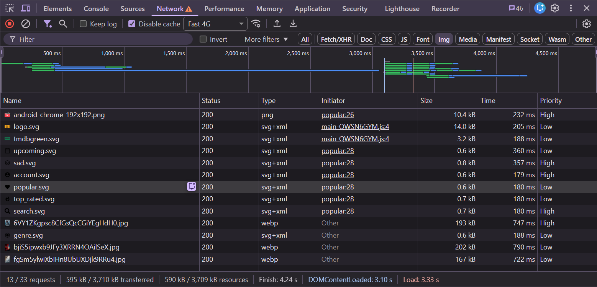
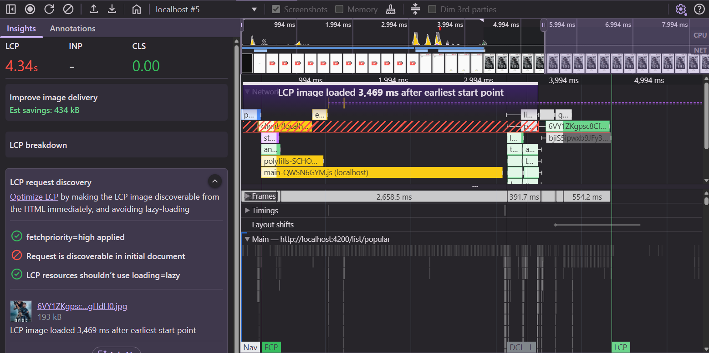
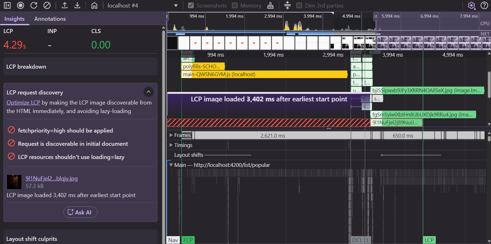

# 04. LCP: Prioritize the LCP Image

In [03](./03-lcp-identify-and-break-down.md) we found that all 20 posters are requested at the same
time and compete for bandwidth with the one that matters: the LCP image.

We have two tools to change that:

* `loading="lazy"` — don't load an image until it gets close to the viewport.
* `fetchpriority="high"` — tell the browser this request is more important than its siblings.

> [!IMPORTANT]
> Do [02. CLS](./02-cls-find-and-fix-layout-shifts.md) first (or check out `solution/02-cls-reserve-space`).
> Without `width` and `height`, every poster is 0px high before it loads — so *all* of them are
> "in the viewport" and lazy loading does nothing. We tried.

```bash
npm run start:prod
```

## 0. Measure the current state

Open the **Network** panel, filter by **Img**, set the network to `Fast 4G` and reload
[http://localhost:4200/list/popular](http://localhost:4200/list/popular).

Right-click a column header and enable the **Priority** column. Note down:

* the number of image requests,
* the total transferred size (bottom bar),
* the priority of the first poster.

Also take a recording and note LCP and its **LCP breakdown** like in exercise 03.

## 1. Lazy load posters

Add `loading="lazy"` to the `img` in `movie-card.component.ts` and measure again.

Then scroll down slowly while watching the Network panel: posters are requested just before they
scroll into view.

## 2. …but never the LCP image

Lazy loading the LCP image is one of the most common LCP mistakes: the browser has to do layout
before it even knows the image is in the viewport, so the request starts later.
**LCP request discovery** flags it with "lazy load not applied ❌".

The `movie-card` has an `index` input with its position in the list. Use it to load the first poster
`eager` and all others `lazy`.

<details>
  <summary>Solution</summary>

```html
<!-- src/app/movie/movie-card/movie-card.component.ts -->


```

</details>

## 3. Prioritize the LCP image

Images start with a **Low** priority and only get boosted once the browser knows they are in the
viewport — which is after layout. `fetchpriority="high"` gives the request a high priority from the start.

Add `fetchpriority="high"` for the first poster and keep the default (`auto`) for the others.

<details>
  <summary>Solution</summary>

```html

```

Branch: `solution/04-lcp-image-priority`

</details>

Measure again: number of image requests, transferred size, priority of the first poster, LCP and
its breakdown. Check **LCP request discovery** once more.

<details>
  <summary>What we measured</summary>

| Measurement                    | Before   | After        |
|--------------------------------|----------|--------------|
| Image requests (Lighthouse)    | 20       | **7**        |
| Transferred (Lighthouse)       | 3.9 MB   | **1.4 MB**   |
| LCP, 1 run, Fast 4G 1280×800   | 4.2 s    | 3.1 s        |

On a phone-sized screen (device toolbar, one column) only 3 posters load, and only the first one
with `High` priority: 595 kB instead of 3.5 MB.



LCP request discovery now shows ✅ for lazy loading and `fetchpriority`. Only
"discoverable in initial document" is still ❌ — we fix that in the [bonus exercise](./10-bonus-lcp-ssr.md).



</details>

## 4. Be skeptical of your own numbers

Run the same measurement 3 times. You'll notice two things:

* **The LCP element changes.** In a 3-column grid, three posters have the same size. Whichever is
  painted first becomes the LCP — not necessarily the one with `fetchpriority="high"`. On a phone
  (one column) it's always the first.

  On a tall desktop window we even got this: two full rows visible, and the smallest poster of the
  *second* row (lazy loaded, no priority) finished first and became the LCP. All three checks red:

  

  The lesson: lazy load only what is really **below the fold**. If a layout shows several equal-size
  images on the first screen, load all of them `eager` (e.g. `index() < 6`) and keep
  `fetchpriority="high"` for one or two.
* **`fetchpriority` barely shows in the lab.** DevTools network throttling slows down each request on
  its own, it doesn't model requests fighting over one slow connection. That's exactly the situation
  where priorities matter on a real network. Lazy loading shows up clearly because it removes requests.

So: optimize based on how the browser works, verify with **several** lab runs, and confirm with field data.

## Takeaways

* Never lazy load the LCP image. Lazy load everything else below the fold.
* `fetchpriority="high"` on the LCP image — and only on very few images.
* Lazy loading needs reserved space to work.

Next: [05. Connect to critical origins early](./05-lcp-preconnect.md)
