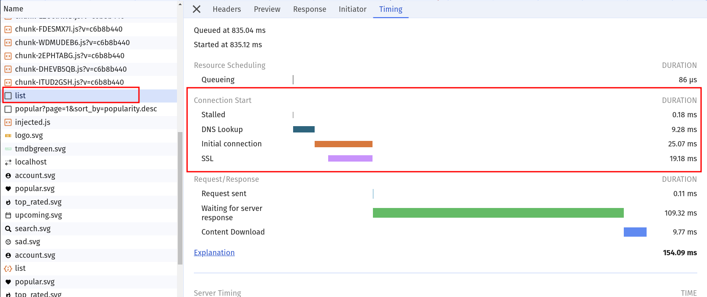
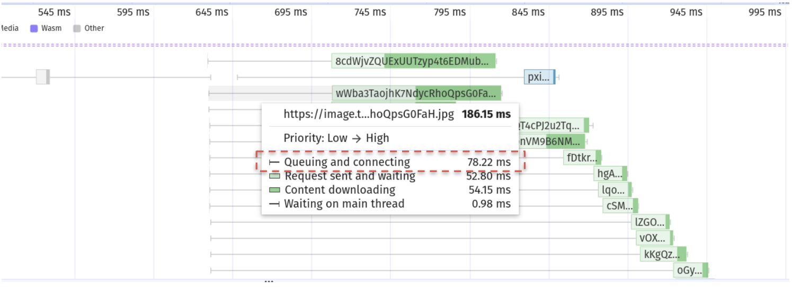
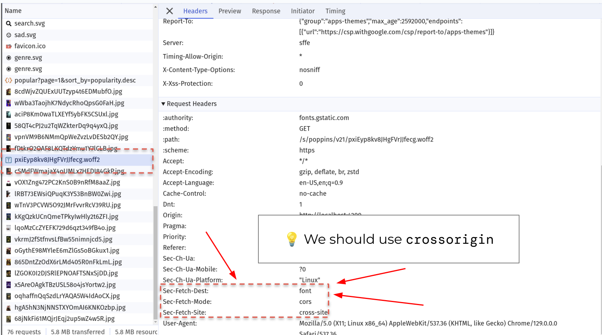

# 05. LCP: Connect to Critical Origins Early

Before the first request to a new origin, the browser has to look up DNS, open a TCP connection and
negotiate TLS. On a mobile network that's easily a few hundred milliseconds — and it's part of the
LCP **resource load delay**.

`<link rel="preconnect">` tells the browser: *"you're going to need this origin, connect now"*.

Our app needs these origins:

| Origin                         | For                                  | Discovered when                    |
|--------------------------------|--------------------------------------|------------------------------------|
| `https://api.themoviedb.org`   | movie data (the poster URLs!)        | after `main.js` ran                |
| `https://image.tmdb.org`       | posters → **the LCP image**          | after the API response rendered    |
| `https://fonts.googleapis.com` | font CSS                             | immediately (`<link>` in the HTML) |
| `https://fonts.gstatic.com`    | font files                           | after the font CSS was parsed      |

> [!NOTE]
> Measure this exercise with a **fresh** browser state. Connections are reused across tabs, so use a
> new Incognito window for every measurement (closing *all* Incognito windows in between).

```bash
npm run start:prod
```

## 0. Measure the current state

### 0.1 Network panel

Open the **Network** panel with `Fast 4G` and reload `/list/popular`. Click the **first** request to
`api.themoviedb.org` and the **first** request to `image.tmdb.org` and open their **Timing** tab.

How long are **Initial connection** and **SSL**? Hover the waterfall bars of later requests to the
same origin: do they connect again?



### 0.2 Performance panel

Record a page load and find the same requests in the **Network** track. The thin line on the left of
a request bar is time spent before the download — including connecting.



## 1. Preconnect

Add `<link rel="preconnect">` tags to the `<head>` of `src/index.html`.

Which origins are worth it? Look at the "discovered when" column: preconnecting to an origin the
browser finds in the HTML anyway gains nothing. And which of them need the `crossorigin` attribute?

<details>
  <summary>Hint: crossorigin</summary>

A preconnected connection can only be reused by a request with the same **credentials mode**.

* The API is called with `fetch` and an `Authorization` header → a CORS request → needs `crossorigin`.
* Font files are always fetched in CORS mode → need `crossorigin`.
* `` without a `crossorigin` attribute is a no-CORS request → **no** `crossorigin`.

You don't have to guess: check the **request headers** of a request in the Network panel.
`Sec-Fetch-Mode: cors` means you need `crossorigin` on the preconnect.



If you get it wrong, the browser simply opens a second connection, and the preconnected one is wasted.

</details>

<details>
  <summary>Solution</summary>

```html
<!-- src/index.html -->

<link rel="preconnect" href="https://image.tmdb.org" />
<link rel="preconnect" href="https://api.themoviedb.org" crossorigin />
<link rel="preconnect" href="https://fonts.gstatic.com" crossorigin />
```

`fonts.googleapis.com` is skipped: its stylesheet is linked right below in the same `<head>`.

Branch: `solution/05-lcp-preconnect`

</details>

Measure again in a fresh Incognito window. The first request to each origin should now show
no (or a much shorter) **Initial connection**.

## 2. Is it worth it?

Be honest with your measurements: compare LCP before and after over several runs.

<details>
  <summary>What we measured</summary>

We could **not** measure a reliable LCP difference in the lab. Our runs varied by more than a second
anyway — the TMDB image CDN alone answers anywhere between 1.8 s and 3.2 s on throttled
connections, which buries the ~100 ms saved by connecting early. In DevTools traces connection
setup is also partly hidden for cross-origin requests.

`preconnect` is still a cheap, safe win for real users on slow networks — as long as you keep it to
the **2–3 origins** you actually need early. Every preconnect costs a socket and CPU, and an unused
one is wasted work.

</details>

## Takeaways

* Preconnect to origins that are critical for LCP but **discovered late**.
* Get `crossorigin` right, or the connection can't be reused.
* Not every good practice shows up in a single lab run. That's fine — know *why* it helps.

Next: [06. Serve right-sized images](./06-lcp-right-sized-images.md)
