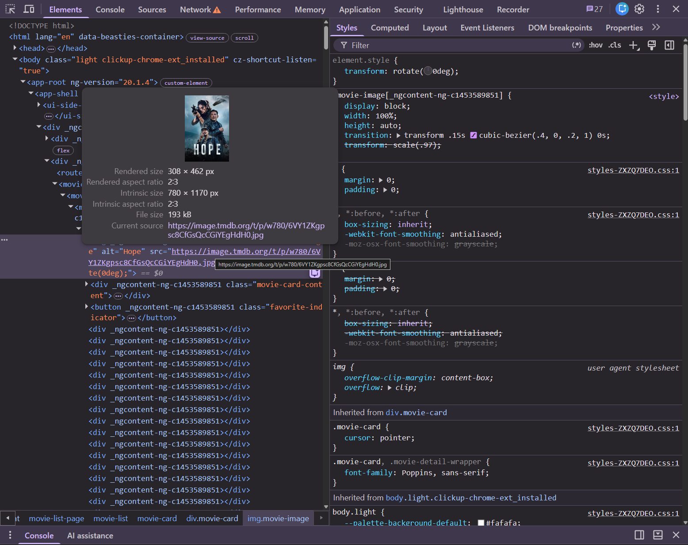
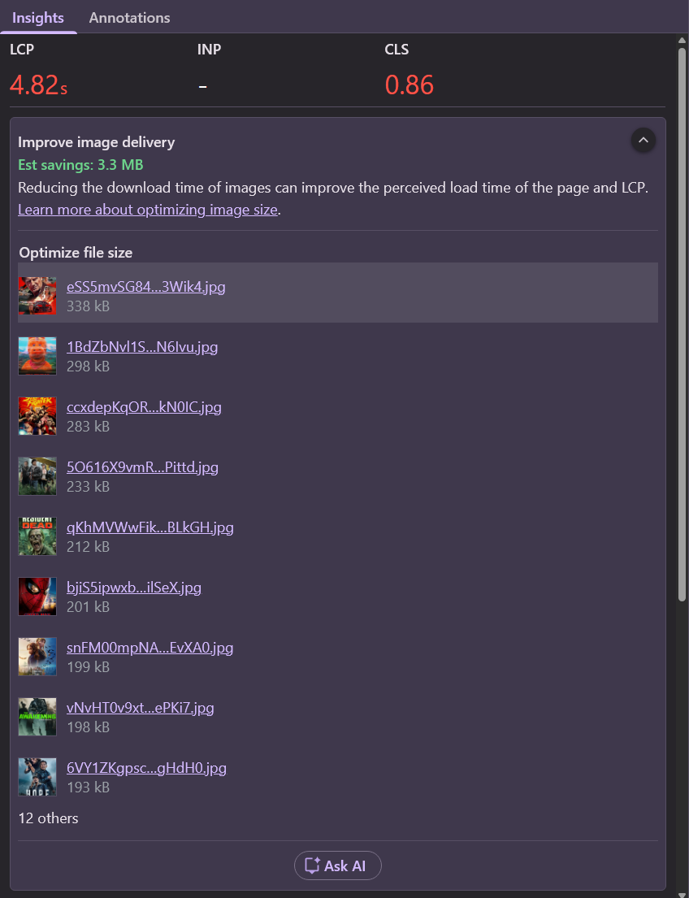
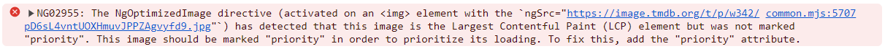
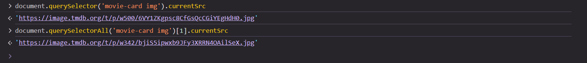

# 06. LCP: Serve Right-Sized Images

Every poster in the grid is requested as `w780` — 780 pixels wide — but displayed at roughly 300px on a
desktop screen. The browser downloads several times more bytes than it can show, and that's
**resource load duration** of the LCP.

TMDB offers each poster in several widths: `w92`, `w154`, `w185`, `w342`, `w500`, `w780`, `original`.
We just need to let the browser pick the right one.

```bash
npm run start:prod
```

## 0. Measure the current state

1. In the **Elements** panel, hover the first `img.movie-image`. The tooltip shows **rendered size**
   and **intrinsic size**. How far apart are they?
2. In the **Network** panel, note the transferred size of the first poster.
3. Record a page load and look at the **Improve image delivery** insight. How many bytes could be saved?

<details>
  <summary>What we measured</summary>

At 1280×800: rendered **308 × 462**, intrinsic **780 × 1170**. The LCP poster weighs ~190 kB.





</details>

## 1. `srcset` and `sizes` — the platform way

With plain HTML you'd write:

```html

```

* `srcset` lists the available files and their widths.
* `sizes` tells the browser how wide the image will be *displayed*, before CSS is applied.
* The browser multiplies that with the device pixel ratio and picks the smallest file that is big enough.

Angular's `NgOptimizedImage` directive generates all of that for us — and also takes care of
`loading`, `fetchpriority` and a few warnings. Let's use it.

## 2. Configure an image loader

A loader turns `(src, width)` into a URL. Add one for TMDB to the providers in `src/app/app.config.ts`.

<details>
  <summary>Solution</summary>

```ts
// src/app/app.config.ts
import { IMAGE_LOADER, ImageLoaderConfig } from '@angular/common';

export const appConfig: ApplicationConfig = {
  providers: [
    // ...
    {
      provide: IMAGE_LOADER,
      useValue: ({ src, width }: ImageLoaderConfig) =>
        src.startsWith('/assets')
          ? src
          : `https://image.tmdb.org/t/p/w${width ?? 780}${src}`,
    },
  ],
};
```

The `/assets` branch keeps the local "no poster available" fallback image working.

</details>

## 3. Use `ngSrc` in the movie card

In `movie-card.component.ts`:

* import `NgOptimizedImage` in the component's `imports`,
* replace `[src]="movie().poster_path | movieImage: 780"` with `[ngSrc]` and the raw `poster_path`,
* add `ngSrcset` with the TMDB widths and a `sizes` attribute,
* replace the manual `loading` / `fetchpriority` from exercise 04 with `[priority]="index() < 1"`.
  `priority` makes the image `eager` + `fetchpriority="high"`; all other images become `lazy` automatically.

<details>
  <summary>Solution</summary>

```ts
// src/app/movie/movie-card/movie-card.component.ts
import { NgOptimizedImage, UpperCasePipe } from '@angular/common';

@Component({
  selector: 'movie-card',
  imports: [StarRatingComponent, TiltDirective, UpperCasePipe, NgOptimizedImage],
  template: `
    <div class="movie-card">
      
      <!-- ... -->
```

Branch: `solution/06-lcp-image-size`

</details>

> [!TIP]
> Run the dev build (`npm run start`) once and check the console. `NgOptimizedImage` warns about
> common mistakes — e.g. an LCP image without `priority`, or a missing `preconnect` for the image origin.
>
> 

## 4. Measure on different screens

Back on `npm run start:prod`:

1. Repeat step 0: rendered vs. intrinsic size, transferred bytes, **Improve image delivery**.
2. Toggle the **device toolbar** (`Ctrl + Shift + M`, Mac: `⌘ + Shift + M`). Try a phone and a
   desktop size, and change the **DPR** (device pixel ratio). Reload each time and check
   `currentSrc` of the first poster in the console:

   ```js
   document.querySelector('movie-card img').currentSrc
   ```

<details>
  <summary>What we measured</summary>



| Screen                   | LCP poster              | Other posters        |
|--------------------------|-------------------------|----------------------|
| before, any screen       | `w780` (~190 kB)        | `w780`               |
| 1280×800, DPR 1          | **`w500`** (~100 kB)    | **`w342`** (~50 kB)  |
| phone (Lighthouse), DPR 1.75 | `w780`              | below the fold       |

Why does the LCP poster get `w500` while the others get `w342`? `sizes` says `350px`, and `342` is
just too small. For lazy images Angular adds `sizes="auto"`: the browser can use the real layout
width (308px). For the eager LCP image layout isn't done yet, so `sizes` has to be your best guess.

On a high-DPR phone the poster really *is* displayed at ~650 physical pixels, so `w780` is right.

</details>

## Takeaways

* Ship images at the size they're displayed, times the device pixel ratio.
* `srcset` + `sizes` let the browser choose; a framework image component saves you the boilerplate.
* `sizes` for above-the-fold images is a guess — make it a good one.

Next: [07. Measure and break down interactions](./07-inp-measure-interactions.md)
