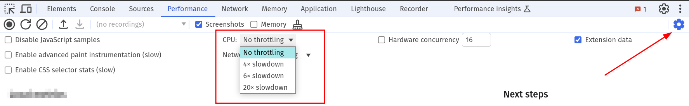
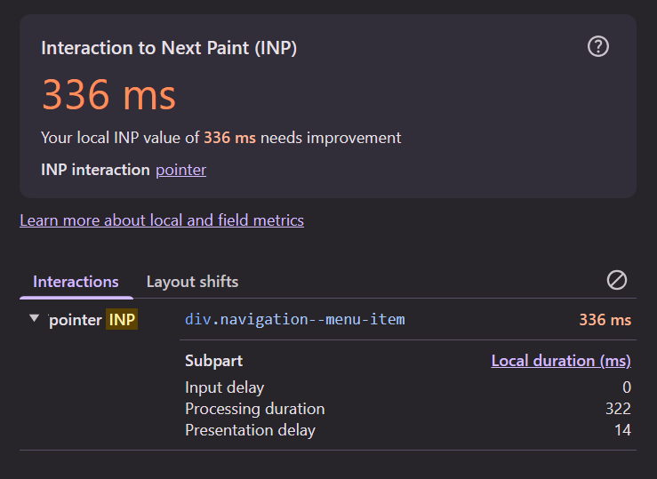
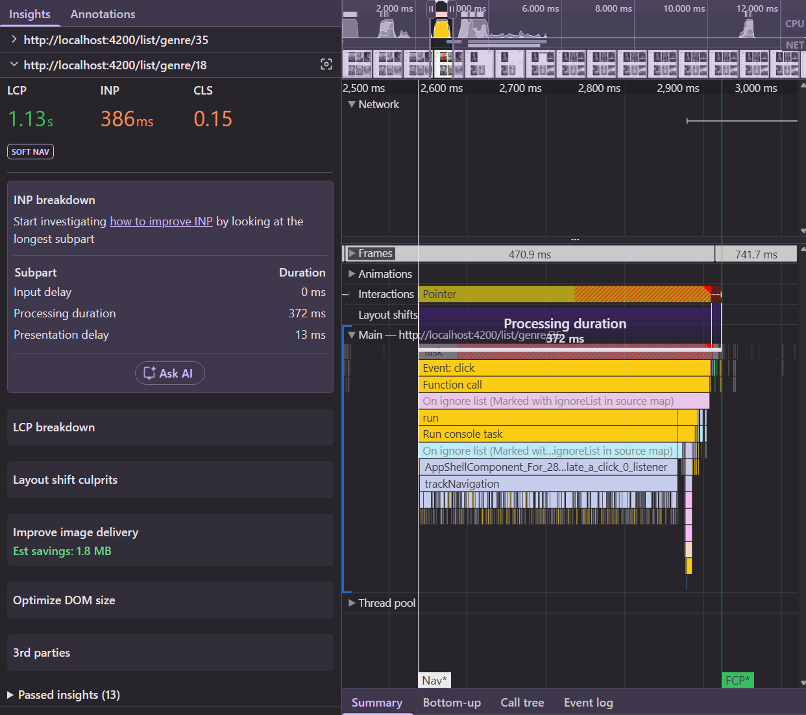
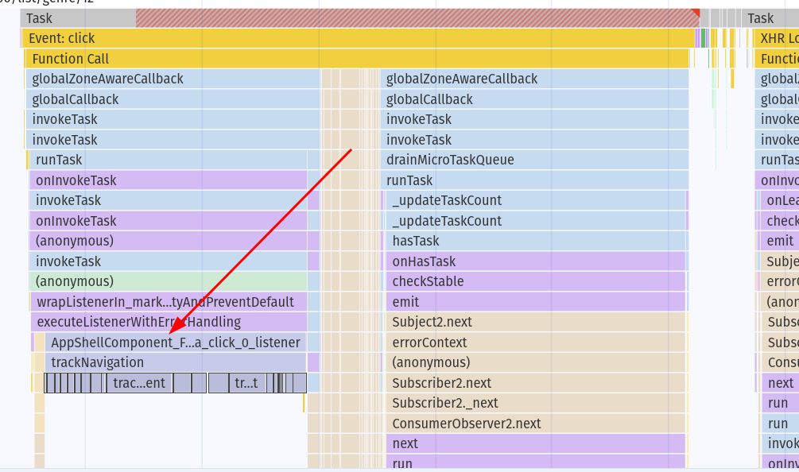

# 07. INP: Measure and Break Down Interactions

INP looks at (nearly) every click, tap and key press during a visit and reports one of the slowest.
For each interaction it measures the time from the input until the **next frame is painted**.
That time has three phases:

| Phase                  | What happens                                                        |
|------------------------|---------------------------------------------------------------------|
| **Input delay**        | the main thread is busy with something else, the event has to wait  |
| **Processing duration**| your event handlers run                                             |
| **Presentation delay** | style, layout, paint of the next frame                              |

Good: ≤ **200 ms**. Poor: > **500 ms**.

For this exercise use the **development build** — function names in the flame chart stay readable:

```bash
npm run start
```

> [!NOTE]
> The sidebar with the navigation links is only visible on wide windows (≈ 1400px and up).
> On smaller screens, open it with the hamburger menu — or make your browser window wider.

## 1. Slow down your CPU

Interactions that feel instant on your laptop can be slow on a phone. In the **Performance** panel set
**CPU throttling** to `6x slowdown`.



> [!WARNING]
> Throttling makes Chrome put a lot of load on your machine. Turn it off when you're done.

## 2. Find slow interactions with live metrics

Without recording, use the app for a minute: click the sidebar links (Popular, Top Rated, genres),
open a movie, like a movie, type in the search.

Watch the **Interactions** log below the local metrics. Every interaction shows its duration;
expand one to see the three phases.

Which interaction is the slowest? Which phase dominates?

<details>
  <summary>What we measured (6x CPU, production build)</summary>

| Interaction            | Duration       | Input delay | Processing | Presentation |
|------------------------|----------------|-------------|------------|--------------|
| click sidebar link     | **136 – 584 ms** | 3 – 11 ms | **117 – 557 ms** | 10 – 25 ms |
| click "Please like me" | 24 – 40 ms     | 15 – 18 ms  | 0 – 5 ms   | 6 – 20 ms    |

Navigation through the sidebar is slow — and it's the **processing** phase.

In the development build it's even slower:



</details>

## 3. Record the interaction

1. Click **Record** (not "record and reload").
2. Click a sidebar link, wait a second, stop the recording.
3. Find the **Interactions** track. The interaction bar shows the input delay as a thin whisker on the left,
   processing as the solid part, and the presentation delay as a whisker on the right.
4. Open the **INP breakdown** insight in the sidebar.



Now look *below* the interaction in the **Main** track. What does the flame chart of the click event
contain? You might find something that shouldn't run on a click :)

<details>
  <summary>Hint</summary>



</details>

<details>
  <summary>Solution</summary>

Inside the `click` event the app calls `AppShellComponent.trackNavigation`, which calls
`TrackingService.trackEvent`:

```ts
// src/app/shared/tracking.service.ts
trackEvent(event: string) {
  for (let i = 0; i < 10_000_000; i++) {
    const test = `${event}${i % 2 === 0}`;
    // pretend to do work;
  }
}
```

An analytics call that runs synchronously in the click handler. The user doesn't care whether
the click was tracked — they wait for the next page. We fix this in [exercise 08](./08-inp-processing-time.md).

</details>

## 4. Explore other interactions

Record and analyze a few more interactions. For each one, note the slowest phase and what causes it:

* typing in the search bar,
* opening / closing the search bar,
* clicking a movie to open the detail page,
* clicking a sidebar link **while** the list is still rendering (right after a previous click).

<details>
  <summary>Hint: the last one</summary>

The new list renders in a single long task after its data arrived. A click that lands during that task
has to wait for it — a big **input delay**. That's [exercise 09](./09-inp-input-delay-dom-size.md).

</details>

## Takeaways

* Use **live metrics** to find slow interactions, a **recording** to explain them.
* Always look at the three phases: they point to completely different fixes.
* Throttle the CPU — your users' devices are slower than yours.

Next: [08. Long processing time: get non-urgent work out of the way](./08-inp-processing-time.md)
