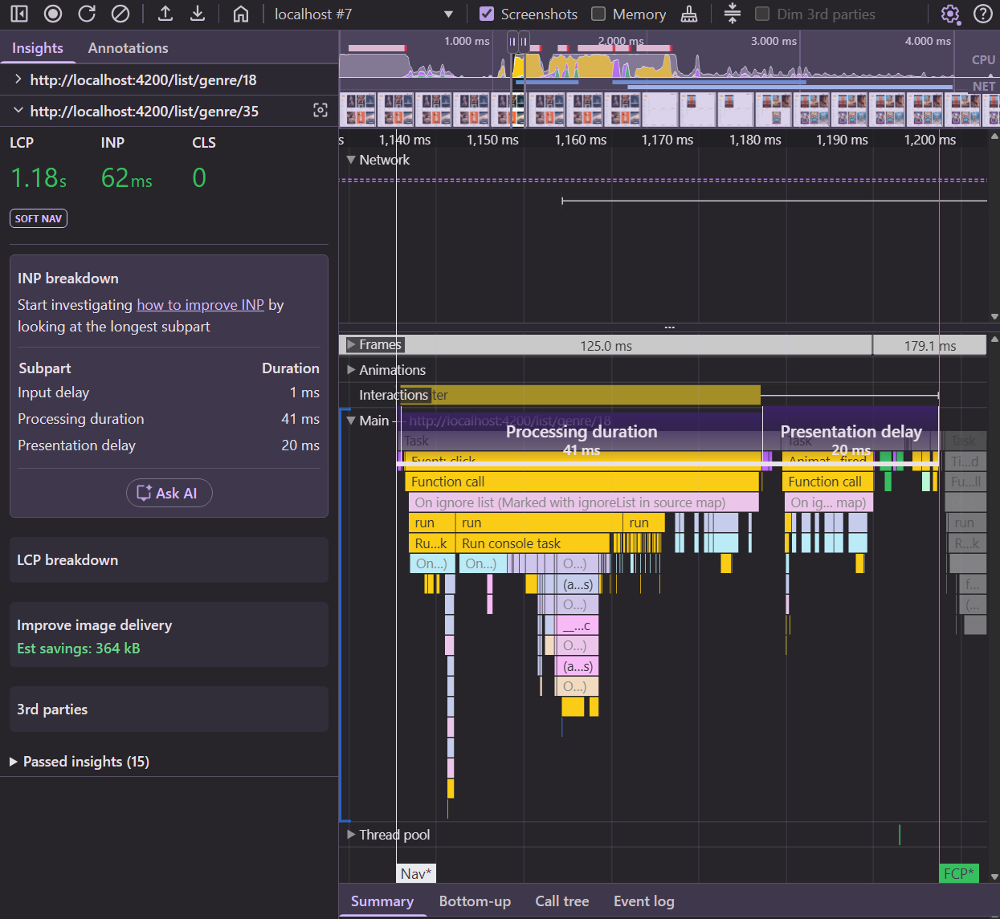
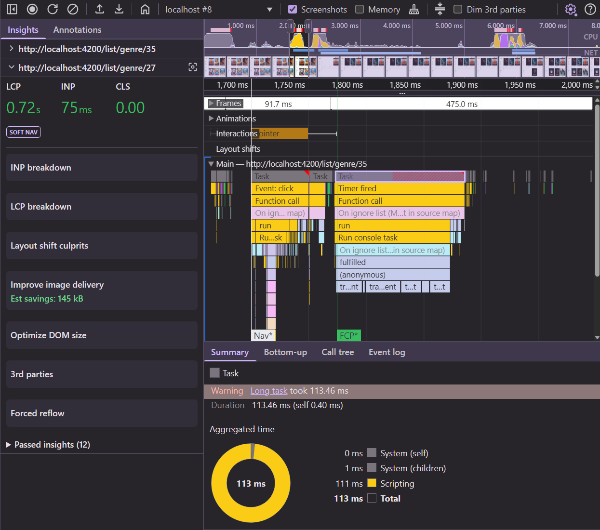

# 08. INP: Long Processing Time — Get Non-Urgent Work Out of the Way

In [07](./07-inp-measure-interactions.md) we found that every sidebar click runs an expensive
`TrackingService.trackEvent()` call **inside** the click handler. The browser can't paint the next frame
until the handler — including the tracking — is done.

The tracking has to happen, but not before the user sees a response. The fix: let the browser
paint first, then do the work.

## 1. Measure the current state

With `npm run start` (or `start:prod`) and **6x CPU throttling**, click 3 different sidebar links and
note the INP of each in the **Interactions** log — duration and processing time.

## 2. Pick the right way to defer

There are several ways to run code "later". They don't all do the same thing:

| API                                                 | Runs                                                        | Next frame painted first? |
|-----------------------------------------------------|-------------------------------------------------------------|---------------------------|
| `queueMicrotask` / `Promise.resolve().then`         | right after the current handler, same task                  | ❌ |
| `setTimeout(fn, 0)`                                 | in a new task — maybe before, maybe after the next frame    | 🤷 |
| `scheduler.yield()`                                 | in a new task, ahead of other queued tasks                  | 🤷 — great for splitting long work, not for "after paint" |
| `requestIdleCallback`                               | when the browser is idle — could be much later              | ✅, but no guarantee when |
| `requestAnimationFrame` → `setTimeout`              | right after the next frame was produced                     | ✅ |

For "do this right after the user has seen the response", the last one is the classic pattern.

## 3. Implement `afterNextPaint`

Create a small helper in `src/app/shared/after-next-paint.ts` that returns a promise which resolves
after the next paint. Then use it in `trackNavigation` of `app-shell.component.ts`.

<details>
  <summary>Solution: the helper</summary>

```ts
// src/app/shared/after-next-paint.ts

/**
 * Resolves after the browser had the chance to paint the next frame.
 * Use it to push non-urgent work (tracking, logging, prefetching) out of an event handler,
 * so the interaction's next paint isn't blocked by it.
 */
export function afterNextPaint(): Promise<void> {
  return new Promise((resolve) =>
    requestAnimationFrame(() => setTimeout(resolve, 0)),
  );
}
```

`requestAnimationFrame` runs right before the next frame is rendered; the `setTimeout` inside it
schedules a task that runs after that frame.

</details>

<details>
  <summary>Solution: use it</summary>

```ts
// src/app/app-shell/app-shell.component.ts
import { afterNextPaint } from '../shared/after-next-paint';

export class AppShellComponent {
  // ...

  async trackNavigation(route: string) {
    // tracking is not needed for the next frame: let the browser paint the navigation first
    await afterNextPaint();
    this.trackingService.trackEvent(`nav to: ${route}`);
  }
}
```

Branch: `solution/08-inp-yield`

</details>

## 4. Measure again

Repeat step 1. Then record one click and compare the flame chart with the one from exercise 07:
where does `trackEvent` run now?

<details>
  <summary>What we measured (6x CPU)</summary>

| Click            | Before                     | After                    |
|------------------|----------------------------|--------------------------|
| Top Rated        | 160 ms (processing 130 ms) | **48 ms** (processing 27 ms) |
| Upcoming         | 136 ms (processing 117 ms) | **40 ms** (processing 22 ms) |
| Genre "Action"   | 584 ms (processing 557 ms) | **72 ms** (processing 47 ms) |

`trackEvent` still runs and still takes the same time — but now in its own task *after* the frame
with the user's response was painted.



Zoom out a little and you'll find it: a short `Event: click` task, then a separate
`Timer fired` task that runs `trackEvent` (113 ms here):



</details>

## 5. Think further

The tracking task still blocks the main thread for >100 ms after the paint. If the user clicks again
during that time, that click gets a big **input delay**. How would you fix that?

<details>
  <summary>Ideas</summary>

* **Make the work cheaper.** Usually the best fix — the loop in `trackEvent` is pure waste.
* **Split it up.** Process in chunks and `await scheduler.yield()` between them, so a new input can
  be handled in between.
* **Move it off the main thread** — a Web Worker or `navigator.sendBeacon` for analytics.

</details>

## Takeaways

* The processing phase is *your* code. Look at what runs in your handlers.
* Do what the user needs to see first; defer everything else until after the next paint.
* Deferring doesn't make work disappear — it moves it. Keep an eye on the tasks you create.

Next: [09. Input delay: long rendering tasks and DOM size](./09-inp-input-delay-dom-size.md)
