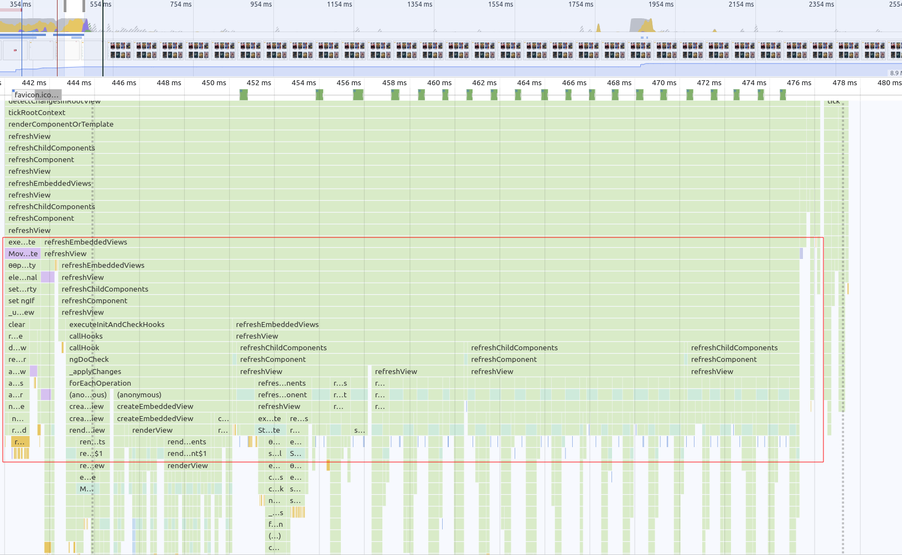
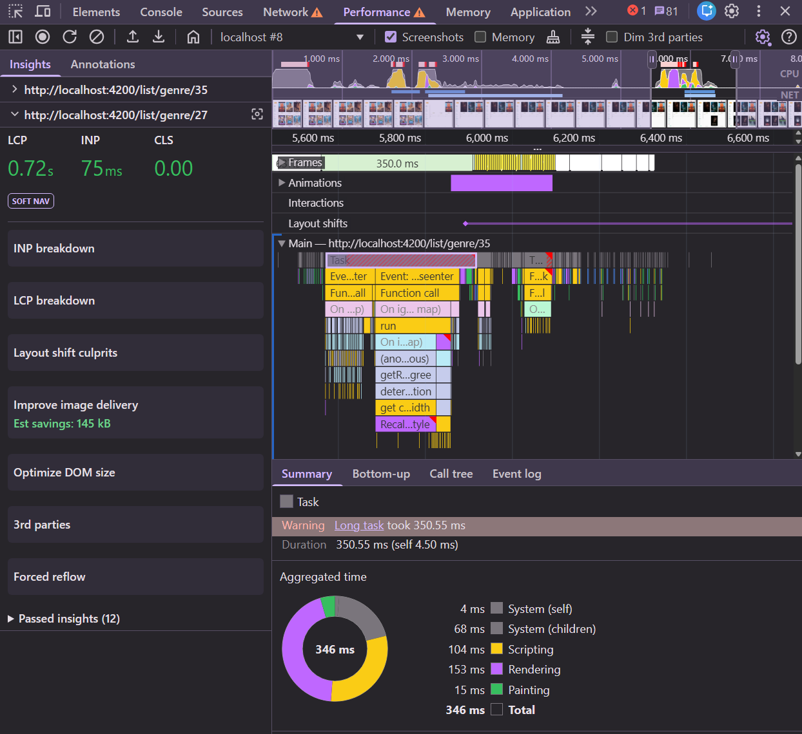
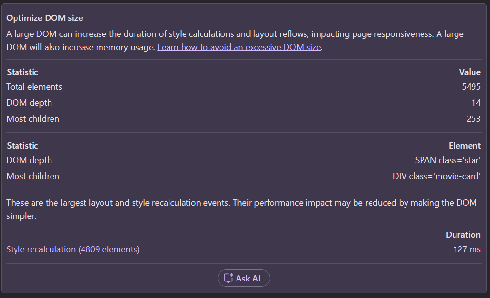
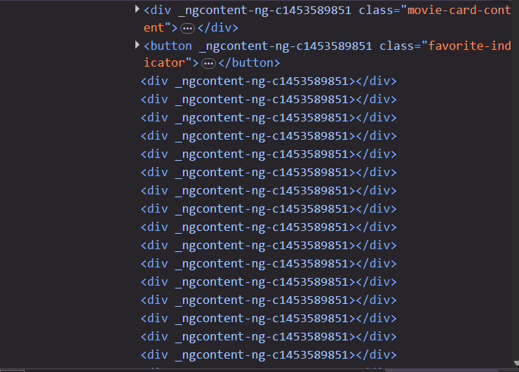

# 09. INP: Input Delay — Long Rendering Tasks and DOM Size

An interaction can be slow even if its own handler is fast: if the main thread is busy when the user
clicks, the event has to wait. That waiting time is the **input delay**.

Where does a busy main thread come from? Often from rendering — and rendering gets more expensive
the more DOM nodes there are.

```bash
npm run start
```

Keep **6x CPU throttling** on.

## 1. Find the long rendering task

1. Open `/list/popular`, start a recording.
2. Click a sidebar link (e.g. a genre) and wait until the new list is visible. Stop the recording.
3. In the **Main** track, look for tasks with a **red corner** — long tasks over 50 ms.
4. Find the one that renders the movie list after the API response arrived. Click it and check the
   **Summary** and **Bottom-up** tabs: how much is scripting, how much is rendering (style, layout)?



<details>
  <summary>What we measured (6x CPU, production build)</summary>

After a navigation the list is rendered in two long animation frames of **314 ms** and **271 ms**.
Any click that happens during those frames waits up to ~300 ms before its handler even starts.

</details>

### 1.1 Not just rendering: hover

While you're in the recording, look for other long tasks. Did you move the mouse over the posters?

<details>
  <summary>What we found</summary>

`Event: mouseenter` on a movie card took **350 ms**, 153 ms of it **rendering**. The card's tilt
effect calls `getBoundingClientRect()`, which forces the browser to recalculate styles for the whole
page first (the red corner on **Recalculate style**, also reported by the **Forced reflow** insight).
Simply moving the mouse across the grid keeps the main thread busy, and the next click has to wait.



</details>

## 2. Provoke the input delay

Click a sidebar link and, **immediately** after, click another one (or a "Please like me" button).
Find the second interaction in the **Interactions** log or track. How long is its input delay?

## 3. How big is the DOM?

Open the **Optimize DOM size** insight of your recording (or run Lighthouse and check **Avoid an
excessive DOM size**). Then count yourself in the console:

```js
document.getElementsByTagName('*').length;
document.querySelector('movie-card').getElementsByTagName('*').length;
```

Inspect a `movie-card` in the **Elements** panel. What's in there?

<details>
  <summary>Solution</summary>

**5,521** elements on the page, **264** of them in every single movie card. A single style
recalculation touches 4,809 elements and takes 127 ms:



Each card renders 250 empty `<div>`s:



```ts
// src/app/movie/movie-card/movie-card.component.ts
@for (item of workItems(); track $index) {
  <div></div>
}

work = input(250);
workItems = computed(() => new Array(this.work()).fill(null));
```

Okay, we planted that one. But real apps get there too: wrapper components around wrapper
components, icon libraries that inline big SVGs, hidden menus and dialogs that are always rendered,
long lists without virtualization.

</details>

## 4. Remove what nobody sees

Delete the placeholder nodes from `movie-card.component.ts` (the `@for` block, the `work` input and
`workItems`), then repeat steps 1–3.

<details>
  <summary>Solution</summary>

```diff
-      @for (item of workItems(); track $index) {
-        <div></div>
-      }
```

```diff
-  work = input(250);
-  workItems = computed(() => new Array(this.work()).fill(null));
```

Branch: `solution/09-inp-dom-size`

</details>

<details>
  <summary>What we measured (6x CPU, production build)</summary>

| Measurement                        | Before          | After             |
|------------------------------------|-----------------|-------------------|
| DOM elements                       | 5,521           | **521**           |
| Long frames after navigation       | 314 ms + 271 ms | **116 ms + 109 ms** |

Smaller DOM → less to create, style and lay out → shorter tasks → less input delay for the next interaction.

</details>

## 5. Bonus: split the remaining work

The list render is still >100 ms. Two ideas to try:

* **`content-visibility: auto`** on cards below the fold lets the browser skip their rendering work
  until they scroll into view. Add `contain-intrinsic-size` so the scrollbar doesn't jump.
* **Chunked rendering.** Instead of rendering 20 cards in one task, render them over several frames.
  The app already ships [RxAngular](https://www.rx-angular.io/), whose `*rxFor` does exactly that:

  ```html
  <!-- movie-list.component.ts, import RxFor from '@rx-angular/template/for' -->
  <movie-card
    *rxFor="let movie of movies(); trackBy: 'id'; let i = index"
    [index]="i"
    ...
  />
  ```

Record again and compare: what happens to the long task — and to LCP?

## Takeaways

* Input delay is caused by *other* work on the main thread — look at what runs **before** the event.
* DOM size multiplies the cost of every render, style recalculation and layout.
* Long tasks can be avoided by doing less, or split by yielding to the browser in between.

Bonus: [10. LCP with server-side rendering](./10-bonus-lcp-ssr.md)
