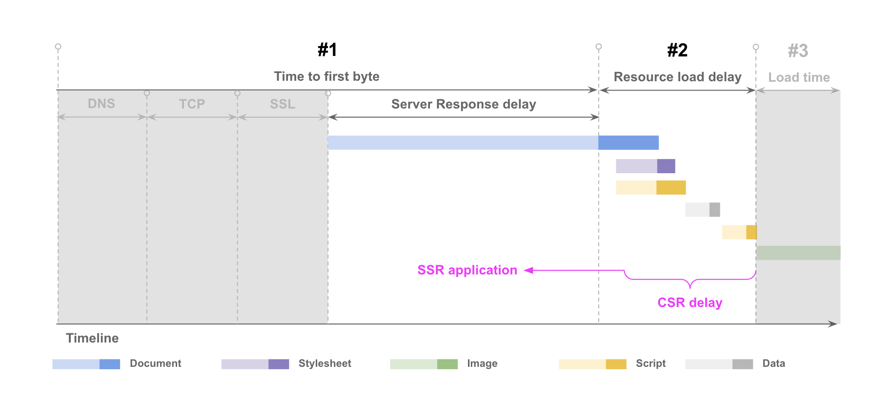
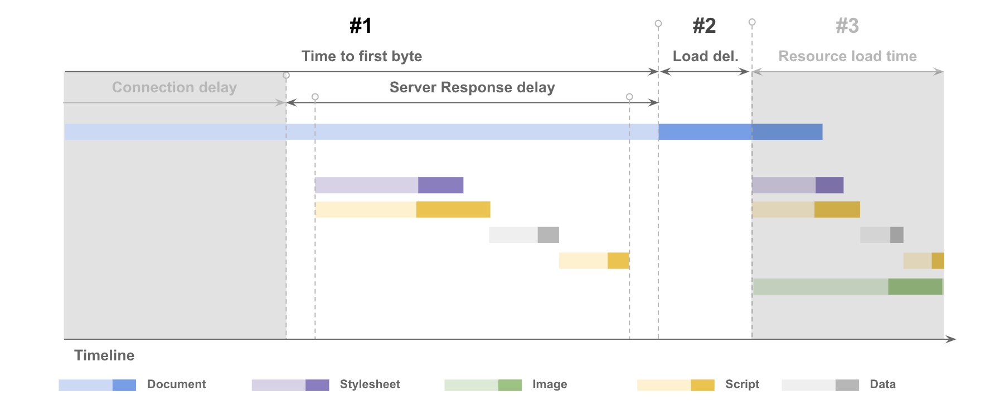
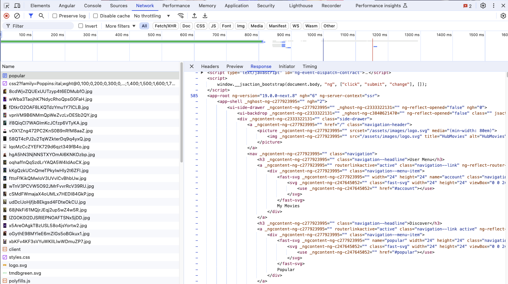
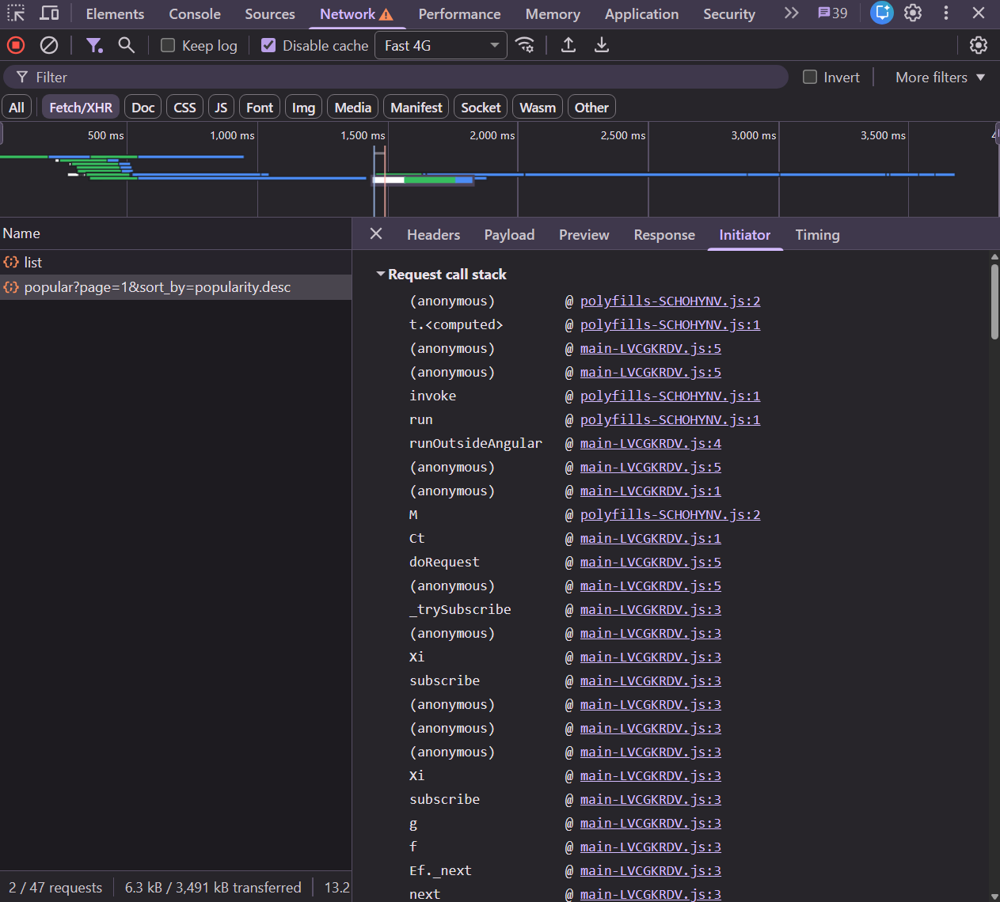

# 10. Bonus: LCP with Server-Side Rendering

After exercises 04–06 one item of **LCP request discovery** is still red:

* ❌ Request is discoverable in initial document

With client-side rendering (CSR) the poster URL only exists after
`HTML → main.js → API → render`. That chain *is* the resource load delay, and no image attribute
can shorten it. Server-side rendering (SSR) can: the server runs the app, calls the API and sends HTML
that already contains the ``.

| CSR                                                                  | SSR                                                                  |
|----------------------------------------------------------------------|----------------------------------------------------------------------|
|  |  |

The price: the server now has to do work before it can send the first byte — **TTFB** goes up.
Let's see if the trade is worth it.

> [!NOTE]
> This exercise is Angular specific, but the trade-offs apply to every SSR framework.
> Start from `solution/09-inp-dom-size` (or your own solution of 09) — you'll see why in step 5.

## 1. Measure the CSR baseline

```bash
npm run start:prod
```

Record a page load of `/list/popular` with `Fast 4G` and note the **LCP breakdown**. Also run
Lighthouse (mobile) 3 times and note the median LCP and its sub-parts.

## 2. Enable SSR

`@angular/ssr`, `server.ts` and `src/main.server.ts` are already in the project. Wire them up:

**2.1 Build an SSR app**: add to `projects.ws-ng-perf.architect.build.options` in `angular.json`:

```json
"outputMode": "server",
"server": "src/main.server.ts",
"ssr": {
  "entry": "server.ts"
}
```

**2.2 Render every route on the server, on request**: create `src/app/app.routes.server.ts`:

```ts
import { RenderMode, ServerRoute } from '@angular/ssr';

export const serverRoutes: ServerRoute[] = [
  { path: '**', renderMode: RenderMode.Server },
];
```

and use it in `src/app/app.config.server.ts`:

```ts
import { provideServerRendering, withRoutes } from '@angular/ssr';
import { serverRoutes } from './app.routes.server';

const serverConfig: ApplicationConfig = {
  providers: [provideServerRendering(withRoutes(serverRoutes))],
};
```

**2.3 Hydrate instead of re-render**: in `src/app/app.config.ts`, add
`provideClientHydration(withEventReplay())` (from `@angular/platform-browser`).

Now run `npm run build`. It should succeed. Start the server:

```bash
npm run build && npm run serve:ssr:ws-ng-perf
```

and open [http://localhost:4000/list/popular](http://localhost:4000/list/popular). Check the terminal.

## 3. Fix the server errors

Code that touches browser-only APIs crashes on the server. You'll meet three of them.

### 3.1 `document is not defined`

`ElementVisibilityDirective` subscribes to `document` scroll events in its constructor.
Run that code only in the browser.

<details>
  <summary>Solution</summary>

```ts
// src/app/shared/cdk/element-visibility/element-visibility.directive.ts
import { afterNextRender } from '@angular/core';

constructor() {
  afterNextRender(() => {   // 👈 only runs in the browser
    fromEvent(document, 'scroll')
      .pipe(/* unchanged */)
      .subscribe(() => this.elementVisible.emit());
  });
}
```

</details>

### 3.2 `window is not defined` in `ngx-fast-svg`

The SVG icon library fetches icons with `window.fetch` and relative URLs. On the server, read them
from disk instead by providing an SSR load strategy.

<details>
  <summary>Solution</summary>

```ts
// src/app/app.config.server.ts
import { readFileSync } from 'node:fs';
import { join } from 'node:path';
import { Injectable, isDevMode } from '@angular/core';
import { provideFastSVG, SvgLoadStrategy } from '@push-based/ngx-fast-svg';
import { map, Observable, of } from 'rxjs';

// On the server there is no `window.fetch` for relative URLs: read the SVGs from disk instead.
@Injectable()
export class SvgLoadStrategySsr implements SvgLoadStrategy {
  config(url: string): Observable<string> {
    return of(url);
  }

  load(url$: Observable<string>): Observable<string> {
    return url$.pipe(
      map((url) => {
        const iconPath = isDevMode()
          ? join(process.cwd(), 'src', url)
          : join(process.cwd(), 'dist', 'ws-ng-perf', 'browser', url);
        return readFileSync(iconPath, 'utf8');
      }),
    );
  }
}

const serverConfig: ApplicationConfig = {
  providers: [
    provideServerRendering(withRoutes(serverRoutes)),
    provideFastSVG({
      svgLoadStrategy: SvgLoadStrategySsr,
      url: (name: string) => `assets/svg-icons/${name}.svg`,
    }),
  ],
};
```

</details>

### 3.3 `window is not defined` in the dark mode toggle

`DarkModeToggleComponent` toggles classes on `window.document.body`. Same fix as 3.1.

<details>
  <summary>Solution</summary>

```ts
// src/app/ui/component/dark-mode-toggle/dark-mode-toggle.component.ts
constructor() {
  super();
  this.set({ isLightTheme: true });
  afterNextRender(() => {
    this.hold(this.isLightTheme$, this.toggleTheme);
  });
}
```

</details>

Rebuild and restart. Open **View page source** on `/list/popular`: the movie cards — and the poster
`` tags — are in the HTML now.



## 4. Gotcha: the app fetches everything twice

Record a page load and look at the **Network** track. After the JavaScript has loaded, do you see
requests to `api.themoviedb.org`? The server already made them!

<details>
  <summary>Why?</summary>

Angular's HTTP **transfer cache** sends the server's API responses along with the HTML, so the
browser doesn't need to repeat them during hydration. But by default it skips requests with an
`Authorization` header — and our `readAccessInterceptor` adds one to every TMDB call.

So the client requests the movies again, re-renders the list when they arrive and the LCP element is
painted again: a long **element render delay**.

In the **Network** panel (filter **Fetch/XHR**) you see both API calls again. The **Initiator** tab
shows they come from our own `main.js`:



</details>

<details>
  <summary>Solution</summary>

```ts
// src/app/app.config.ts
import {
  provideClientHydration,
  withEventReplay,
  withHttpTransferCacheOptions,
} from '@angular/platform-browser';

provideClientHydration(
  withEventReplay(),
  // our interceptor adds an Authorization header, which the transfer cache skips by default
  withHttpTransferCacheOptions({ includeRequestsWithAuthHeaders: true }),
),
```

Only do this for responses that are the same for every user — they end up in the HTML.

Branch: `solution/10-lcp-ssr`

</details>

## 5. Measure and compare

Record a page load and run Lighthouse 3 times, like in step 1. Compare:

* **LCP request discovery** — all green now?
* each **LCP sub-part**, CSR vs. SSR,
* the **size of the HTML document** in the Network panel.

<details>
  <summary>What we measured (Lighthouse mobile, 3 runs each)</summary>

| Sub-part               | CSR (after 09)  | SSR (after 09)   |
|------------------------|-----------------|------------------|
| Resource load delay    | 3.1 – 7.5 s     | **1.1 – 1.7 s**  |
| Resource load duration | 2.0 – 3.2 s     | 3.4 – 4.5 s      |
| **LCP (median)**       | 6.8 s           | **5.7 s**        |

* LCP request discovery: all three checks ✅. `NgOptimizedImage` even adds a
  `<link rel="preload" fetchpriority="high">` for the `priority` image to the server-rendered HTML.
* The **load delay** shrinks a lot — that's the chain we broke.
* The **load duration** grows: the poster now downloads at the same time as the JavaScript bundle and
  shares the bandwidth with it. The next bottleneck is image bytes ([06](./06-lcp-right-sized-images.md) on mobile).

**Why start from exercise 09?** We ran SSR with the 250 empty divs per card still in place. The HTML
document was **267 kB** instead of **106 kB**, and SSR was *slower* than CSR. DOM size is a loading
problem too.

</details>

## Takeaways

* SSR makes the LCP resource discoverable in the HTML and removes most of the resource load delay.
* It moves cost elsewhere: TTFB, HTML size, competing downloads. Measure every sub-part, not just LCP.
* Avoid double work during hydration — check the Network track for repeated requests.

---

🎉 Done! You've measured and fixed all three Core Web Vitals. Back to the [overview](../README.md).
